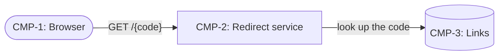
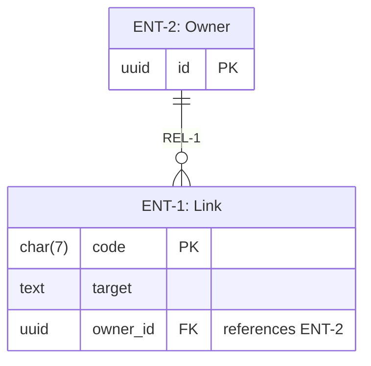
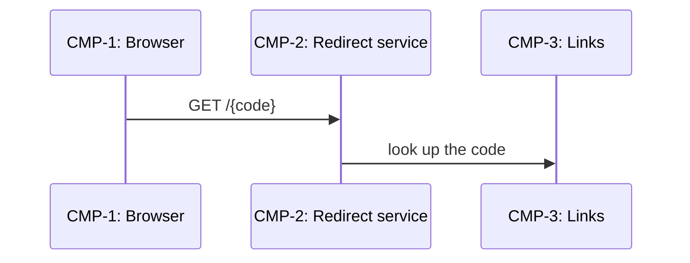

# Jira hand-off — URL shortener

## 1. Your role

You are creating Jira issues for **URL shortener**. This file is your only source: every issue you create comes from it, and nothing else does. Work through the sections below in order, follow the mapping table exactly as the user has left it, and stop and ask whenever this file does not settle a question.

## 2. Jira project

- Site: 
- Project key: 

If either line is blank when you start, ask the user for it before doing anything else.

## 3. Mapping table — edit this table to match your Jira, then follow it exactly

| Concept | Jira issue type | Parent | Links |
|---|---|---|---|
| Feature (`F-n`) | Epic | — | — |
| User story (`US-n`) | Story | The Epic of its feature | — |
| Ticket (`T-nn`) | Task | The Epic of its first delivered story | "relates to" each delivered story; "is blocked by" each blocking ticket |

## 4. Rules

- Create exactly one issue per ID listed in sections 5 to 7, and nothing else: no extra issues, sub-tasks, features, stories or tickets.
- Use each item's **Summary** line as the issue summary and its remaining fields as the description, as given. Format them for Jira; do not reword them.
- Create in this order: features, then stories, then tickets in ID order, so every parent and link target exists when you need it.
- Paste each open gap (section 8) into the description of its feature's Epic, under the heading "Open gaps and accepted risks". Never create an issue for a gap.
- Before creating anything, search the project for issues whose summary starts with any ID in this file. If one exists, stop and ask.
- If an issue type or link type named in the mapping table does not exist in the project, stop and ask.
- If anything else is ambiguous, stop and ask. Never guess and never fill a gap with your own content.

## 5. Features

### F-1: Short links

- **Summary:** F-1: Short links
- **Description:** Short links description
- **Requirements:**
  - FR-1: Users shorten a long URL  (exactly as typed).
  - FR-2: Visitors are redirected from a short URL

### F-2: Link owners

- **Summary:** F-2: Link owners
- **Description:** Link owners description
- **Requirements:**
  - FR-3: Owners see their links

## 6. User stories

### US-1

- **Summary:** US-1: To shorten a long URL
- **Feature:** F-1
- **Story:** As an anonymous user, I want to shorten a long URL, so that I can share it.
- **Requirements:** FR-1, NFR-1
- **Acceptance criteria:**
  - Criterion 1.1
  - Criterion 1.2
- **Delivered by:** T-01

### US-2

- **Summary:** US-2: To be redirected from a short URL
- **Feature:** F-1
- **Story:** As an anonymous user, I want to be redirected from a short URL, so that I reach the page.
- **Requirements:** FR-2
- **Acceptance criteria:**
  - Criterion 2.1
  - Criterion 2.2
- **Delivered by:** T-02

### US-3

- **Summary:** US-3: To see my links
- **Feature:** F-2
- **Story:** As a link owner, I want to see my links, so that I can manage them.
- **Requirements:** FR-3
- **Acceptance criteria:**
  - Criterion 3.1
  - Criterion 3.2
- **Delivered by:** T-03

## 7. Tickets

### T-01: Walking skeleton

- **Summary:** T-01: Walking skeleton
- **Parent feature:** F-1 (from US-1)
- **Delivers stories:** US-1
- **Blocked by:** None
- **Kind:** slice
- **What to build:** Shorten a URL end to end.
- **Acceptance criteria:**
  - [ ] POST /urls returns a code

### T-02: Redirect

- **Summary:** T-02: Redirect
- **Parent feature:** F-1 (from US-2)
- **Delivers stories:** US-2
- **Blocked by:** T-01
- **Kind:** slice
- **What to build:** Resolve a code to its URL.
- **Acceptance criteria:**
  - [ ] GET /{code} answers 301
  - [ ] Unknown codes answer 404

### T-03: Owner list

- **Summary:** T-03: Owner list
- **Parent feature:** F-2 (from US-3)
- **Delivers stories:** US-3
- **Blocked by:** T-01
- **Kind:** slice
- **What to build:** List an owner's links.
- **Acceptance criteria:**
  - [ ] Lists links newest first

## 8. Open gaps

### F-1: Short links

- **GAP-1** (security, high; affects FR-1): Risk: Open creation Decision needed: Who? Note: v1

## 9. Report

When you have finished, reply with:

1. A table with columns ID, Issue type, Jira key, Parent key, Links created, with one row per ID in sections 5 to 7.
2. A list of anything you did not create and why. It should be empty.

## Appendix: diagrams (reference only)

These illustrate the design. They are not items: do not create issues from them.

### Architecture

### Data model

### Sequence: FLOW-1 Follow a short link (read)

---

*Ticket and spec method: to-tickets / to-spec, mattpocock-skills 1.2.3 (MIT, © 2026 Matt Pocock).*
